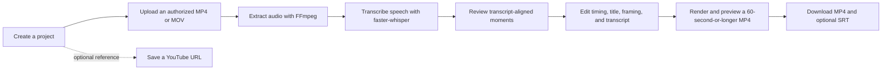
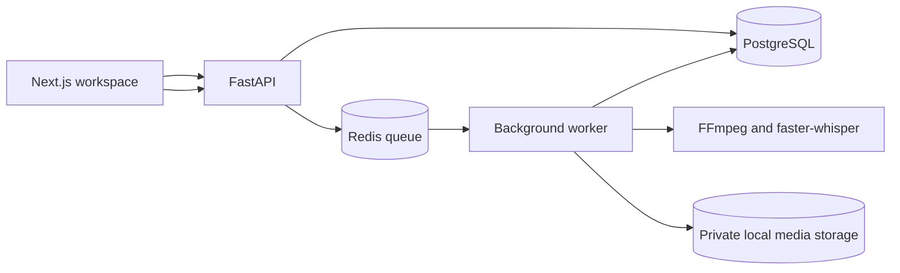

# ClipForge AI


**[Try it locally](#try-it-locally)** · [See the workflow](#the-clipforge-workflow) · [Features](#what-you-can-do) · [Roadmap](docs/implementation-roadmap.md)

ClipForge AI is a local-first video editing project for turning a long video you own or are allowed to process into a short-form draft. It transcribes speech, proposes moments tied to transcript timestamps, and gives you an editor to shape and render a clip. Every rendered MP4 is at least 60 seconds long, keeps the source audio, and has no captions burned into the picture; captions can be downloaded separately as an SRT file.

ClipForge does not fetch video from YouTube URLs, generate pictures, or claim that a clip will trend. A YouTube URL can be saved as a project reference; to make clips, upload the authorized MP4 or MOV file. Suggested moments are chronological and need a human to choose what works.

> **Try it:** there is no public hosted demo yet. Follow the [local setup](#try-it-locally), then choose **Try it without signing in**. That starts a private trial workspace on your own computer. The `localhost` address is local to the computer running the app; it is not a shared public website.

## The ClipForge workflow



1. **Start a project.** Give it a name. A YouTube URL can be saved as a reference if useful.
2. **Add your video.** Upload an MP4 or MOV you own or have permission to process. ClipForge accepts files up to 500 MB and 60 minutes.
3. **Get the transcript.** A background worker extracts audio with FFmpeg and transcribes it locally with faster-whisper. Timestamped transcript segments and job progress are saved in PostgreSQL.
4. **Choose a moment.** Review candidate moments beside their transcript excerpts. The app presents moments for human review; it does not rank them by virality.
5. **Make the draft yours.** Adjust the in/out points, title, aspect ratio, crop/focus, and transcript corrections. The clip must be at least 60 seconds.
6. **Preview and export.** Render an MP4 with the source sound, then download it. Captions are a separate SRT file and are not overlaid on the video.

## What you can do

| In ClipForge | What it means |
| --- | --- |
| Local guest workspace | Try project creation and editing without entering an email or password. Guest access is for local development and cannot be recovered if its browser session is lost. |
| Video intake | Upload permitted MP4/MOV files (500 MB, 60-minute maximum) or save a YouTube URL as a project reference. |
| Transcript and moment review | Follow transcription progress, inspect timestamped text, and review transcript-aligned candidate windows. |
| Creator editor | Preview the source audio and video, set clip timing, edit the title and transcript, and adjust portrait/square/landscape framing. |
| Video export | Render a 60–180 second MP4 with original sound and download its separate SRT captions file. |
| Workspace access | Use local owner/editor/reviewer accounts, optional invitations, and project-level membership controls. |

### What this project does not do

- It does **not** download or transcribe a video from its YouTube URL. Upload an authorized video file to process it.
- It does **not** predict trends, promise virality, or automatically decide which moment will perform best.
- It does **not** add generated pictures or burn captions into the exported MP4.

## How the pieces fit together

The Next.js workspace talks to a FastAPI backend. PostgreSQL stores projects, transcripts, and job state; Redis wakes a separate worker; the worker uses FFmpeg and faster-whisper for media processing. Source files and renders stay in local private storage in the Docker setup, with source files automatically deleted after seven days.



The implementation roadmap and milestone notes document what is complete and what remains.

## Current milestone: production readiness

- Next.js landing page shell (`http://localhost:3000`)
- FastAPI liveness endpoint (`http://localhost:8000/health`)
- FastAPI dependency readiness endpoint (`http://localhost:8000/health/ready`)
- PostgreSQL 16 and Redis 7 with health checks and persistent local volumes; PostgreSQL is built locally with pinned gosu 1.20 source and a govulncheck gate
- Local project creation and private MP4/MOV upload with permission confirmation
- PostgreSQL migrations, file and duration limits, local storage quota, deletion, and seven-day source expiry
- Durable transcription jobs and timestamped transcript segments stored in PostgreSQL
- Separate Python worker for FFmpeg audio extraction and faster-whisper transcription
- Job status, retry, cancellation, language detection, and transcript inspection in the workspace
- Transcript-aligned candidate windows with duration controls, factual boundary signals, creator edits, and select/reject review
- Durable creator-triggered render jobs with bounded private MP4/SRT storage, cancellation/retry, progress, preview, and downloads
- Every new MP4 export is at least 60 seconds long; the local maximum defaults to 180 seconds
- Autosaved timeline/title edits, transcript caption corrections, local output presets, crop mode, and focus controls
- Local account setup/sign-in, project ownership by team, owner/editor/reviewer roles, one-time invitations, password changes, and session/CSRF checks

YouTube URL references are stored with projects, but YouTube video bytes are not fetched or processed; transcription still requires an authorized local MP4/MOV upload. Candidate windows are chronological and have no quality score until a human-reviewed sample set and rubric are agreed. Milestones 4 and 5 implement local rendering and a creator editor; Milestone 6 adds local accounts, team ownership, and editor/reviewer roles. See the [rendering](docs/milestone-4-rendering.md), [creator editor](docs/milestone-5-creator-editor.md), and [accounts/collaboration](docs/milestone-6-accounts-and-collaboration.md) notes. These accounts are still a local-development implementation: email delivery/recovery, MFA, an external identity provider, and production security operations remain open. The landing page's review panel is illustrative. Keep the API, worker, and workspace on the local machine; do not expose this scaffold to a network or submit secrets.

## Prerequisites

For the Docker quick start, install and start Docker Desktop (or Docker Engine with the Compose plugin). The recommended transcription target is an Apple Silicon Mac with 16 GB unified memory; other machines may run it, but transcription speed and available resources will vary. The worker uses faster-whisper `small` on CPU with int8 compute. It downloads the pinned model weights the first time you transcribe a video, so the first job can take a few minutes and needs an internet connection.

## Try it locally

Docker runs PostgreSQL, Redis, the API, the transcription worker, and the frontend together. From the repository root:

```sh
git clone https://github.com/alphonsnj/ClipForge-AI.git
cd ClipForge-AI
docker compose up -d --build
docker compose ps
```

Wait for the API and frontend to report healthy, then open **[http://localhost:3000](http://localhost:3000)** and choose **Try it without signing in**. In the workspace, choose **New project**, upload a permitted MP4/MOV, confirm the permission checkbox, and start transcription. Guest access is enabled only in local Compose and uses the same project isolation, CSRF checks, and rate limits as account sessions. Its browser session can’t be recovered if lost, so download exports before signing out. The first transcription downloads the speech model and may take a few minutes.

To stop the app while keeping projects and uploads, run `docker compose down`. This local setup binds the app and database ports to loopback; keep it on this computer.

## Manual host development

Install Node and Python with Homebrew if needed:

```sh
brew install node@22 python@3.12
brew install ffmpeg
brew install --cask docker
```

Open Docker Desktop and wait for it to start. From the project root:

```sh
cp .env.example .env
cp backend/.env.example backend/.env
cp frontend/.env.example frontend/.env.local
docker compose up -d --build
```

Start the frontend in one terminal:

```sh
cd frontend
npm install
npm run dev
```

Start the API in a second terminal:

```sh
cd backend
python3.12 -m venv .venv
source .venv/bin/activate
python -m pip install --upgrade pip
python -m pip install -r requirements.txt
set -a; source .env; set +a
alembic upgrade head
uvicorn app.main:app --reload --host 127.0.0.1 --port 8000
```

Start the transcription worker in a third terminal, using the same backend virtual environment and configuration:

```sh
cd backend
source .venv/bin/activate
set -a; source .env; set +a
python -m app.worker
```

Open `http://localhost:3000`. Create a project at `http://localhost:3000/workspace`. Intake accepts MP4/MOV, up to 500 MB, one hour long, with a 2 GB total local-media quota and one concurrent upload per API process. Sources are kept in the private `data/media/` directory and deleted after seven days; users can also delete a source or project sooner. You must affirm ownership or permission for each upload. Start one transcription worker only; it serializes model work for the 16 GB local target. The first transcription downloads the model weights, so allow time and disk space for that step. Liveness is available at `http://localhost:8000/health`; readiness checks PostgreSQL and Redis at `http://localhost:8000/health/ready`.

For account-based work, create the initial workspace owner account. Additional people join through manually copied, 24-hour invitation links. Owners manage invitations; editors can make projects; reviewers can read and preview without changing project state. Run `alembic upgrade head` before opening the workspace. See [Milestone 6 account and role details](docs/milestone-6-accounts-and-collaboration.md).

Transcription jobs and transcript rows are durable in PostgreSQL. Redis wakes the worker, while PostgreSQL polling recovers queued jobs if Redis loses a notification. Completed transcript segments include start/end millisecond timestamps and detected language. Candidate runs preserve source boundaries and transcript excerpts, and record creator selection, rejection, and edits. They do not assign quality scores or estimate virality. A synthetic English transcription smoke passed; representative-language benchmarks and human candidate evaluation remain open. Keep target-language evaluation recordings permission-cleared and outside Git. See [Milestone 2 notes](docs/milestone-2-transcription.md), [Milestone 3 notes](docs/milestone-3-candidates.md), and the [validation log](docs/validation-log.md).

Stop local services with `docker compose down`. This keeps the development volumes. To intentionally remove local database/cache data, use `docker compose down -v`.

## Configuration

`.env.example` is for Compose. `backend/.env.example` configures the API, worker, model, and source-retention limits. `frontend/.env.example` contains the API base URL. These examples contain local development values only; use separate secret-managed configuration for any shared or production environment. Relative `MEDIA_STORAGE_DIR` paths resolve from the repository root.

For a deployment behind an HTTPS reverse proxy, run the API from `backend/` with `python -m app.server`, set `HOST` and `PORT` for the private application interface, and set `TRUSTED_PROXY_IPS` to the exact proxy IPs/CIDRs. Uvicorn will honor forwarded client addresses only from those peers; the default trusts loopback only. Do not expose the API directly to untrusted networks. This entry point does not make the application production-ready by itself.

Hosted launch preparation is captured in the [provisional launch plan](docs/hosted-launch-plan.md) and [`compose.hosted.yaml`](compose.hosted.yaml). The package is a single-node private-beta scaffold with same-origin proxy routing, isolated data networks, resource caps, private persistent volumes, and a one-time private first-owner bootstrap. It is not deployed and its example configuration intentionally contains invalid placeholders.

## Roadmap

See the [implementation roadmap](docs/implementation-roadmap.md) for the staged scope, exit criteria, dependencies, and open decisions. Local backup/restore tooling, CI dependency/image scans, structured request/job/auth events, and local operations/security-review notes have been added. The [internal launch policy brief](docs/launch-policy-brief.md) records implementation facts and decisions for future jurisdiction-specific review; it is not a publishable policy. Representative-media transcription and candidate evaluation, editor/browser review, and independent security review remain open. Local account controls do not satisfy public deployment requirements.

For a local database backup, run `scripts/db-backup.sh`. To verify an archive can be restored, run `scripts/db-restore-check.sh /path/to/clipforge-YYYYMMDDTHHMMSSZ.dump`; the script restores into a uniquely named temporary database and removes it afterward. These PostgreSQL archives include account and project data, are not encrypted by this local tooling, and do not include media files. Keep them private and out of Git. Production backups need encryption, access controls, retention rules, media coverage, and a documented restore objective.

YouTube URL references accept watch, youtu.be, shorts, and live links and are stored without network fetching. YouTube metadata access does not grant rights to download or process video bytes. Link-based video processing remains deferred until an authorized byte-access method is defined; use a permitted local file upload meanwhile.
